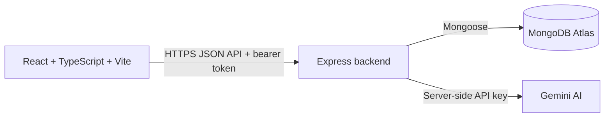

# Campus Lost & Found

A cyberpunk-themed campus lost-and-found app for browsing reports, reporting found or lost items, submitting claims, and getting AI feedback on project descriptions.

## Live deployment

- Frontend: [https://itelect4-project-it4b.vercel.app](https://itelect4-project-it4b.vercel.app)
- Backend health: [https://itelect4-backend.vercel.app/api/health](https://itelect4-backend.vercel.app/api/health)

## Local setup

1. Use Node.js 24 or newer and run `npm ci`.
2. Copy `.env.example` to `.env.development.local` and set `VITE_API_URL=http://localhost:4000`.
3. Start the backend in the `itelect4-backend` repository.
4. Start the frontend with `npm run dev`. The default Vite port is `5173`.

## Scripts

- `npm run dev` starts the Vite development server.
- `npm test` runs the component, hook, and form tests.
- `npm run test:watch` reruns tests while files change.
- `npm run lint` checks the code with ESLint.
- `npm run build` type-checks and creates the production bundle.

## Architecture

The browser talks only to the backend. The Gemini API key is held by the backend and must never be placed in a frontend environment variable.

## CI and tests

GitHub Actions runs ESLint, the test suite, and the production build on every push and on pull requests to `main`. Frontend tests run in jsdom and cover an item component, a custom hook, and validation that blocks an invalid AI request.

**AI-use disclosure:** AI tools assisted with implementation and test drafting; the changes and test results were reviewed locally.
